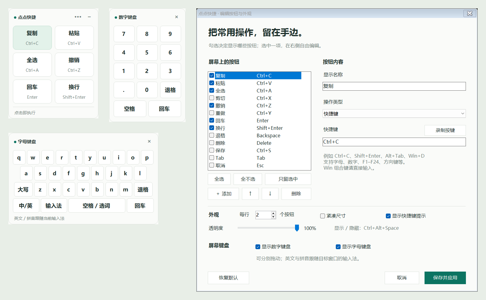

# ClickDeck · 点点快捷

用鼠标点击执行快捷键的 Windows 桌面悬浮工具栏。自由选择屏幕上的按钮，点击时保留原窗口的输入焦点。

A customizable Windows floating shortcut toolbar that preserves the target window's focus.



## 下载与使用

前往 [最新版本](https://github.com/lincei359/clickdeck/releases/latest)，下载 `ClickDeck-v1.1.0-Windows.zip`，解压后双击 `ClickDeck.exe`。无需安装。升级时先退出旧版，已有配置会自动沿用。

运行环境：Windows 10 / 11，.NET Framework 4.8 或更高版本。

1. 在需要操作的软件中选中文字或点击输入位置。
2. 点击悬浮栏按钮，执行复制、粘贴、全选等操作。
3. 点击右上角 **···** 编辑按钮，勾选决定显示哪些操作。
4. 只显示“复制”：选中复制 → 只留选中 → 保存并应用。
5. 按住工具栏顶部空白区域拖动位置。
6. 在设置的“屏幕键盘”中，分别勾选“显示数字键盘”和“显示字母键盘”，再保存。也可在系统托盘菜单中切换。

详细操作见 [使用说明](docs/usage.zh-CN.md)。

## 功能

- 预设复制、粘贴、全选、剪切、撤销、重做、Enter、Shift+Enter、退格、删除、保存、Tab、Esc。
- 自由添加、删除、隐藏和排序按钮；最多保存 80 项。
- 自定义组合键，也可录制 Ctrl / Shift / Alt 组合；Win 组合键支持直接填写。
- 常用文字按钮，支持中文、表情和多行文字。
- 可独立开关的数字键盘：0–9、小数点、退格、空格、回车，不依赖 Num Lock。
- 可独立开关的 26 字母 QWERTY 键盘：大小写、中/英、输入法切换、空格选词和退格；支持英文与系统拼音输入法。
- 两组键盘各自可拖动，自动保存位置和显示状态。
- 每行 1–6 个按钮，紧凑尺寸、快捷键提示和透明度可调。
- 悬浮置顶、拖动位置、滚动长列表、系统托盘和显示 / 隐藏热键。
- 自动保存配置；再次启动恢复已有悬浮栏。
- 离线运行，不收集操作记录，不修改开机启动项。

配置保存在 `%LOCALAPPDATA%\ClickDeck\settings.json`。

字母键盘发送真实按键，由目标窗口当前的输入法处理。英文模式下输入英文；拼音模式下点击字母组成拼音，再用“空格 / 选词”确认候选词，也可点候选词或使用数字键选词。“中/英”发送 Shift，“输入法”发送 Win+Space；具体切换方式遵循系统和输入法设置。参见 [微软拼音操作说明](https://support.microsoft.com/zh-CN/Windows/Hardware/Input-Devices/microsoft-simplified-chinese-ime)。

Enter 和 Shift+Enter 的效果取决于目标软件。普通权限程序无法向管理员权限窗口发送按键，其他兼容性说明见 [使用说明](docs/usage.zh-CN.md#无反应时)。

## 从源码构建

使用 Windows 自带的 .NET Framework C# 编译器，不需要下载第三方包或安装 .NET SDK。

```powershell
git clone https://github.com/lincei359/clickdeck.git
cd clickdeck
powershell -NoProfile -ExecutionPolicy Bypass -File .\source\build.ps1
```

生成的 `ClickDeck.exe` 位于仓库根目录。将它和 `ClickDeck.ico` 放在一起运行。

## 验证

本机已通过 195 项检查，涵盖原有快捷操作、0–9 和 26 个字母实际点击输入、大小写、焦点保持、两组键盘的独立显示与保存，以及在微软拼音中点击 `nihao` 并用空格确认“你好”。拼音集成检查仅在本机已启用微软拼音时运行，否则会明确跳过。

完整验证需要可交互的 Windows 桌面：

```powershell
powershell -NoProfile -ExecutionPolicy Bypass -File .\source\tests\run-tests.ps1
```

测试会暂时占用鼠标、焦点和剪贴板，结束后恢复，请在不操作电脑时运行。测试数据写入独立临时目录，不修改用户配置。GitHub Actions 自动构建程序、编译测试工具并提供运行包；实际点击测试需要在交互桌面上运行。

## 项目结构

```text
source/
  Program.cs              程序入口与单实例启动
  Native.cs               Windows 输入与窗口接口
  Model.cs                操作配置和持久化
  Toolbar.cs              悬浮工具栏
  Settings.cs             按钮和外观编辑
  Keyboard.cs             独立数字键盘和字母键盘
  build.ps1               构建脚本
  tests/                  独立测试编辑器与验证脚本
docs/                     使用说明与界面预览
ClickDeck.ico             程序和托盘图标
LICENSE                   MIT 许可
```

## 参与开发

欢迎通过 [Issues](https://github.com/lincei359/clickdeck/issues) 提交使用问题或建议，也欢迎提交 Pull Request。描述问题时请附 Windows 版本、目标软件和复现步骤。

## 开源许可

[MIT License](LICENSE)。
